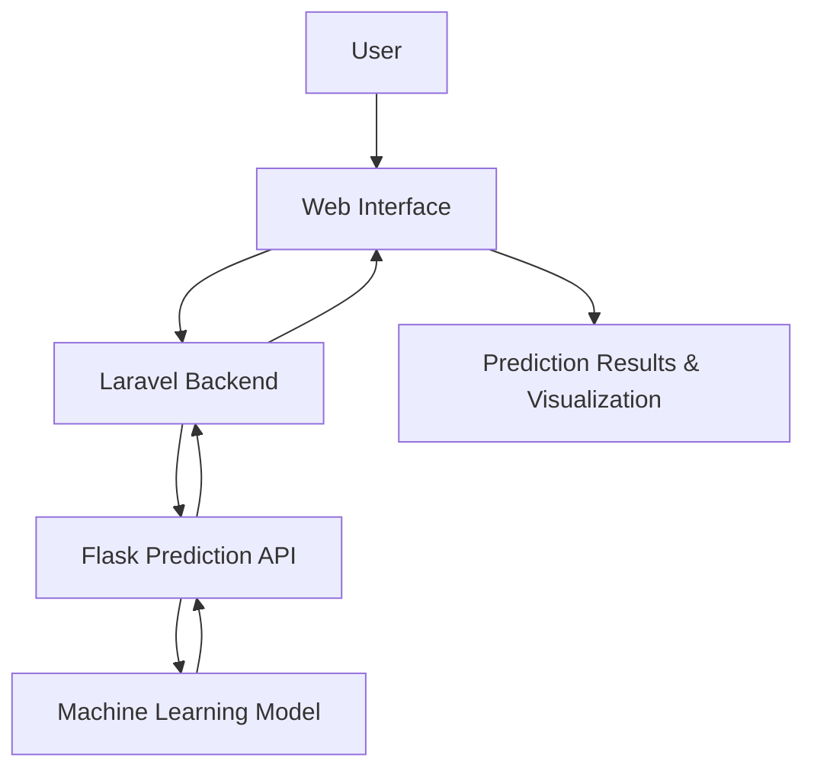

# 🪐 ExoHunter
### AI-Powered Exoplanet Detection Platform

**NASA Space Apps Challenge 2025 | A World Away: Hunting for Exoplanets with AI**

**Laravel · Python · Flask · REST APIs · Machine Learning Integration**

*Exploring distant worlds through artificial intelligence and software engineering.*

### 🎥 [Watch the Project Demo](https://drive.google.com/file/d/1Gmj7orJLyPLzwyAcyvXJcyeZtbh6rdGs/view)

---

## 📖 Overview

**ExoHunter** is an AI-powered web platform developed during the **NASA Space Apps Challenge 2025**.

The project addresses the challenge **"A World Away: Hunting for Exoplanets with AI"**, exploring how machine learning can help identify potential exoplanets using astronomical data from NASA's Kepler and TESS missions.

ExoHunter combines a Laravel web application with a Python Flask prediction service, allowing users to interact with an AI model through a web interface.

The project was developed collaboratively within a 48-hour hackathon, bringing together software development, machine learning, and space science.

> **Project Status:** This repository contains the original hackathon prototype (V1). Further improvements and refactoring are planned.

---

## 🔭 The Challenge

Discovering exoplanets involves analyzing astronomical observations to identify signals that may indicate planets orbiting distant stars.

NASA missions such as **Kepler** and **TESS** have collected large amounts of astronomical data, creating opportunities to apply machine learning techniques to exoplanet candidate classification.

Our challenge was to build a solution that combines AI-based prediction with an accessible interface for exploring potential exoplanet discoveries.

### Our Approach

ExoHunter brings together three main components:

- **Astronomical Data:** Kepler and TESS mission datasets used for machine learning.
- **AI Prediction Service:** A Python-based service that processes prediction inputs and returns classification results.
- **Web Application:** A Laravel-powered interface that connects users with the prediction functionality.

---

## 🚀 Key Features

### 🪐 Exoplanet Classification

The platform integrates a machine learning model designed to classify potential exoplanet candidates based on astronomical data.

### 🤖 AI Model Integration

A Python Flask API provides an interface for accessing the project's machine learning prediction functionality.

The Laravel application communicates with this service to submit prediction inputs and receive results.

### 🌐 Interactive Web Interface

The application provides a web-based interface for interacting with the prediction service and viewing classification results.

### 📊 Data Visualization

Chart.js is used to support visual presentation of astronomical data and prediction-related information.

### 🔗 Cross-Technology Integration

The project demonstrates integration between two different backend technologies:

- Laravel and PHP for the web application.
- Python and Flask for serving AI predictions.

---

## 🏗️ System Architecture

ExoHunter uses a web application and a separate AI prediction service.

Laravel handles the web application's backend functionality and communication with the frontend.

Flask provides the API layer for interacting with the machine learning model.

### High-Level Architecture

### Laravel Application

The Laravel application is responsible for:

- Handling application requests.
- Connecting the frontend with the prediction service.
- Preparing and sending prediction inputs.
- Processing responses from the Flask API.
- Presenting results through the web interface.

### Python Flask Service

The Flask service provides a dedicated API for the AI model.

Its responsibilities include:

- Receiving prediction requests.
- Processing model inputs.
- Executing model inference.
- Returning prediction results in a structured format.

### Frontend

The frontend uses Tailwind CSS and JavaScript to provide a responsive interface.

Chart.js supports data visualization within the application.

---

## 🛠️ Technology Stack

| Category | Technologies |
|---|---|
| Web Backend | PHP, Laravel |
| AI API | Python, Flask |
| Machine Learning | AI Classification Model |
| Frontend | HTML, CSS, Tailwind CSS, JavaScript |
| Visualization | Chart.js |
| Communication | RESTful APIs, JSON |
| Data Sources | NASA Kepler & TESS |
| Version Control | Git, GitHub |

---

## 👨‍💻 My Contributions

**Abdalrhman Hamed — Backend Development & AI Integration**

My primary contributions focused on developing the web application backend and integrating the machine learning service with the user interface.

I worked on:

- Developing backend functionality using Laravel and PHP.
- Integrating the Laravel application with the Python Flask prediction API.
- Implementing request handling and communication between the application and AI service.
- Processing prediction responses and connecting them to frontend functionality.
- Contributing to the web interface using Tailwind CSS and JavaScript.
- Debugging integration issues and helping deliver the working prototype during the hackathon.

**The machine learning model was developed and trained by other members of the team.** My role focused on backend engineering, API integration, and connecting the AI functionality with the web application.

---

## 🧠 Engineering Experience

ExoHunter provided practical experience in several areas of software engineering.

### Integrating Different Technologies

Connecting a Laravel application with a Python-based service through RESTful API communication.

### AI Service Integration

Working with machine learning prediction endpoints and handling model inputs and outputs within a web application.

### Backend & Frontend Communication

Developing the application functionality needed to connect user interactions with backend processing and AI predictions.

### Hackathon Development

Collaborating with a multidisciplinary team, prioritizing core functionality, and delivering a working prototype within a limited timeframe.

---

## 🎥 Project Demo

A demonstration of the original ExoHunter prototype is available below.

### [▶️ Watch ExoHunter Demo Video](https://drive.google.com/file/d/1Gmj7orJLyPLzwyAcyvXJcyeZtbh6rdGs/view)

The video presents the application and its AI-powered exoplanet classification functionality.

---

## 🏆 NASA Space Apps Challenge 2025

**Event:** NASA Space Apps Challenge 2025

**Challenge:** A World Away: Hunting for Exoplanets with AI

**Project:** ExoHunter

**Development Time:** 48 Hours

ExoHunter was developed as a collaborative hackathon project, combining machine learning, astronomical data, backend development, and web technologies.

The experience provided an opportunity to work on a scientific problem while applying practical software engineering skills.

---

## 🔮 Future Improvements

Potential improvements to the original prototype include:

- [ ] Refactoring the Laravel and Flask integration.
- [ ] Improving API error handling and validation.
- [ ] Enhancing astronomical data visualization.
- [ ] Adding automated tests.
- [ ] Containerizing the application using Docker.
- [ ] Improving setup and deployment documentation.
- [ ] Evaluating model improvements with the AI development team.

---

## 👨‍💻 Developer

**Abdalrhman Hamed**

Software Engineer | Backend Development & AI Integration

[LinkedIn](https://www.linkedin.com/in/abdalrhman-hamed-5b929725b/) · [GitHub](https://github.com/abood3omar)

---

*ExoHunter — Exploring the universe through artificial intelligence and software engineering.*
